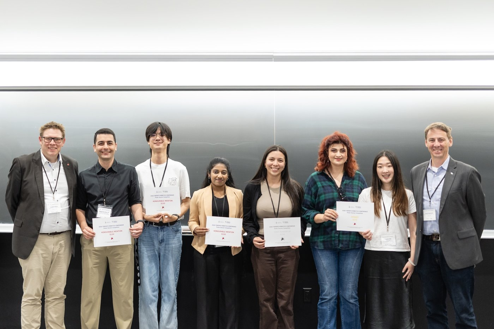

I'm a MASc student in Mechanical Engineering at the University of Toronto, working in the 
[Continuum Robotics Laboratory](https://crl.utm.utoronto.ca/) under Prof. Jessica Burgner-Kahrs. 
My research focuses on contact-rich manipulation with compliant robots. I combine embedded 
magnetic sensing with model-based estimation so that tendon-driven continuum robots can infer 
external contact with their surroundings, to improve teleoperation and to bring contact 
information into control loops.

Before my MASc, I completed a BASc in Engineering Science (Electrical and Computer Engineering) 
at the University of Toronto with honours. For my undergraduate thesis, I built an 
[open-source extensible continuum robot](/portfolio/03-extensible-tdcr/) for research and 
education. As an undergraduate researcher, I also worked in the Harada Lab at Osaka University, 
where I designed a [variable-stiffness gripper for food handling](/portfolio/04-osaka-gripper/) 
and published my first first-author paper, and in the STARS Laboratory at the University of 
Toronto with Prof. Jonathan Kelly, where I co-authored an ICRA 2025 paper on inferring planning 
domains for task and motion planning and presented its spotlight talk and poster.

## Research Interests

- Embedded sensing and state estimation for compliant manipulators
- Reinforcement learning for contact-rich manipulation
- Open-source robot platform development

## Awards & Honours

- **Ontario Graduate Scholarship (OGS)**, Government of Ontario and University of Toronto (2026–2027)
- **First Runner-Up, Poster Session Competition**, Toronto Robotics Conference (2026)
- **NSERC Undergraduate Student Research Award (USRA)** (2024)
- **1st Place, Undergraduate Category**, IEEE Solid-State Circuits Society Arduino Contest (2023), 
for a [ternary-encoded two-key musical instrument](/portfolio/07-ternary-instrument/)
- **ESROP Global Fellowship**, University of Toronto, and **FrontierLab Mini**, Osaka University (2023), 
supporting my research placement in Japan

*Poster competition award recipients at the 2026 Toronto Robotics Conference.*

## Selected Activities

- Montréal Robotics Summer School (Mila, 2025): selected for a fully funded program in 
manipulation, motion planning, reinforcement learning, and perception
- Robotics competition judge, FIRST Tech Challenge (2025)