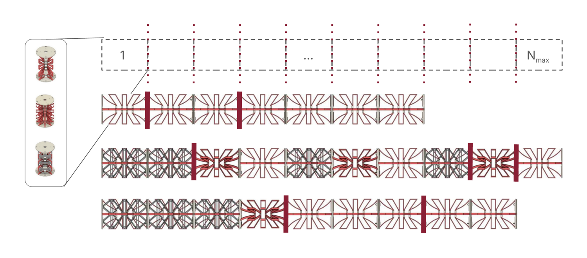
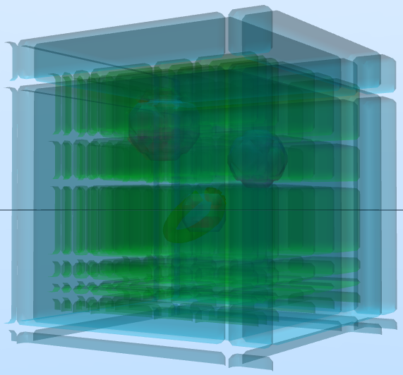
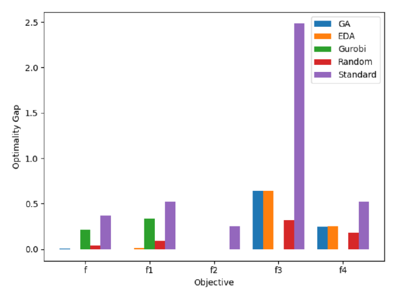

**Problem:** Modular tendon-driven continuum robots (TDCRs) are assembled from prefabricated 
units with different stiffness and mass, which makes them easy to build, reconfigure, and 
repair. But choosing a design means picking how many units to use, which unit goes where, and 
where to split the robot into independently actuated segments: a combinatorial design space 
that prior TDCR optimization work, built around continuous geometry and a fixed number of 
segments, doesn't cover. Checking whether a design can reach its target workspace is also 
expensive, since it relies on Monte Carlo sampling of hundreds of thousands of robot 
configurations per design.

**Approach:** We encoded each design as a discrete vector of unit types and segment boundaries 
(6–10 units from 3 unit types, split into 1–4 segments) and required every design to reach at 
least 95% of the target workspace. To make optimization tractable, we trained surrogate models 
to predict reachability and design objectives (sag, length, actuation effort, and mass), then 
embedded them in a genetic algorithm (GA), an estimation of distribution algorithm (EDA), and a 
binary integer program solved with Gurobi.

**My contribution:** This was a graduate course project (MIE1666) completed in a team of four. 
I framed the original problem, extending continuous TDCR design optimization to the modular 
units developed in my lab, and led the kinematics and data side of the project:

- **Kinematic simulator:** developed the piecewise-constant-curvature forward and inverse 
kinematics for heterogeneous modular robots, with each unit's curvature scaled by its bending 
stiffness, and the two-stage reachability evaluation (forward-kinematics sampling, then 
damped least-squares inverse kinematics for designs near the threshold)
- **Dataset generation:** generated the 1,810-design training dataset by evaluating randomly 
sampled designs in a voxelized workspace with obstacles and target regions, using 500,000 
forward-kinematics samples per design (about 5 minutes each)
- **Simulation validation:** re-evaluated optimized designs in full simulation to check whether 
surrogate-predicted feasibility held up
- **Baseline comparison:** compared optimized designs against random search and a hand-designed 
reference robot

I also contributed to the GA/EDA implementation, surrogate model training, and the Gurobi 
formulation.

**Result:**

- A CNN surrogate predicted the composite objective almost perfectly (R² = 0.999) and 
reachability with R² = 0.986, outperforming Gaussian process, MLP, and graph neural network 
models.
- With the surrogate in the loop, GA and EDA runs took about one second each instead of minutes 
per design evaluation, and both found designs with a composite score about 27% lower (better) 
than the hand-designed reference.
- Simulation validation showed where surrogates fall short: Gurobi strictly enforced the 
*predicted* reachability constraint, but only 3 of its 5 designs stayed feasible in full 
simulation. This motivated adding a simulation check before accepting any surrogate-optimized 
design.

**[Project Report (PDF)](/files/modular-tdcr-report.pdf)**

**Tools:** Python, NumPy, inspyred (GA/EDA), PyTorch, PyTorch Geometric, scikit-learn, Gurobi 
(Gurobi Machine Learning), CRVisToolkit, Google Colab
