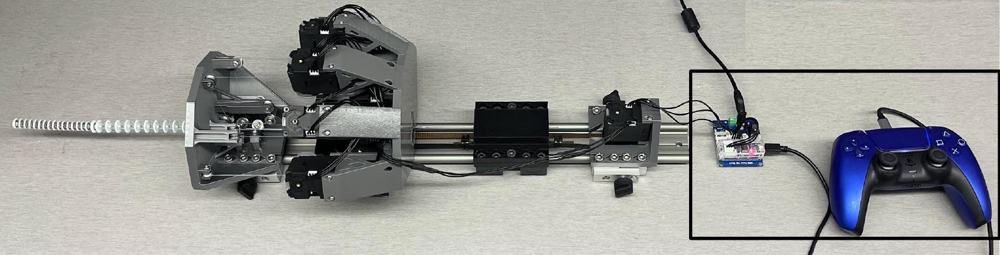
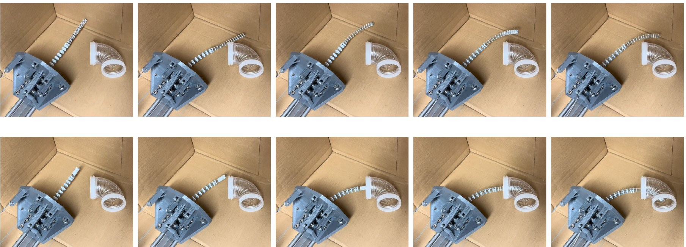

**Problem:** Continuum robots are slow and costly to prototype, and learning materials are 
scarce, which keeps many researchers and students out of the field. Several open-source 
tendon-driven continuum robots (TDCRs) exist, but none has an extensible segment, a segment 
that can lengthen and shorten. Extensibility enables motions such as follow-the-leader 
deployment and lets a robot reach into spaces it otherwise couldn't.

**My contribution:** For my undergraduate thesis in the Continuum Robotics Laboratory (supervised 
by Prof. Jessica Burgner-Kahrs), I designed, built, and evaluated a two-segment TDCR made 
entirely of off-the-shelf and 3D-printed parts:

- **Manipulator:** a fixed-length 13 mm proximal segment with five tendons and an extensible, 
roughly 10 mm distal segment with three tendons. The extensible segment adapts the design of 
Nguyen et al.: a telescoping Nitinol tube-and-rod backbone with magnetic spacer disks of 
alternating polarity that push apart as the segment lengthens. I redesigned the spacer disks so 
they can be adapted to different magnet sizes.
- **Actuation unit:** built around an igus rail, with nine DYNAMIXEL motors (one per tendon and 
one for extension) and a belt drive I designed to extend and retract the backbone. Most parts print 
without support material and include alignment ledges and tool access holes to make assembly 
easier.
- **Teleoperation:** extended the lab's Python teleoperation code so a PlayStation DualSense 
controller drives all degrees of freedom at once, with joysticks for bending and triggers for 
extension, plus a tendon-tensioning mode that removes manual tension adjustment.

**Result:**

- Adding extension turned the distal segment's workspace from a curved surface into a volume of 
about 877,000 mm³ (measured by revolving the segment's workspace cross-section).
- Follow-the-leader deployment achieved an area-based error of 0.078. Prior work reported 0.14 to 
0.15, though on paths with larger bends, so it isn't a direct comparison.
- In pipe-inspection tests, the robot could only reach and enter the pipe by using its 
extensible segment.
- Limitation: the spacer disks sometimes stuck to the backbone during motion instead of 
self-distributing, and only re-spaced once the segment straightened. Reducing that friction is 
the main next step.

**[Watch the demo](https://youtu.be/u-8E7-xkPwE)** · 
**[GitHub: design files and assembly instructions](https://github.com/rozmarco/extensible_tdcr)**

**Tools:** CAD, 3D printing, DYNAMIXEL motors, Python