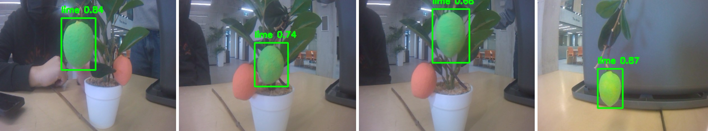

**Problem:** Small hillside farms often can't access the automation that large farms use, so 
harvesting stays manual and physically demanding. Limón mandarinas are a particularly hard case: 
the fruit is small, green, hidden in dense foliage, and has a short shelf life, and picking it 
often means climbing trees on steep terrain. We worked with Finca Pedras Grandes, a small farm in 
Costa Rica, to design a drone that could find the fruit and cut it from the tree for workers to 
collect from the ground.

**Approach:** This was my undergraduate robotics capstone (ROB498) in a team of four. The system 
had four subsystems: fruit detection, stereo depth mapping, voxel-map path planning, and a 
servo-driven, 3D-printed scissor arm for cutting fruit.

**My contribution:** I led the fruit detection subsystem and its integration with the harvesting 
arm:

- **Detection model:** fine-tuned a YOLO11 Nano model in stages, first on a public lime dataset, 
then on green-skinned fruit among foliage, then on images from the farm, to make up for having 
very few labeled images of the actual fruit
- **Farm dataset:** hand-labeled the farm images, tiled them to 320×240 to match the onboard 
camera resolution used for real-time inference on the Jetson Nano, and expanded the training set 
with 10 augmentations per image (lighting, blur, noise, perspective, and more)
- **Detection-to-actuation:** connected detection output to the arm's servo controller, so a 
confident, centered detection triggers the cutting motion

**Result:**

- On 26 held-out farm images, the detector reached a precision of 0.899, recall of 0.771, and F1 
score of 0.830, meeting our targets (precision ≥ 0.85, recall ≥ 0.60). Most errors were heavily 
occluded fruit and leaves mistaken for fruit.
- In the final demo, detection running on the drone's hardware correctly identified the 
prototype fruit and triggered the arm.
- Across the team's subsystems, the stereo depth map measured a 25 cm target at 25.27 cm 
(1.08% error) with about 0.2 s latency per frame, the voxel map reconstructed obstacles to within 
about ±10 cm, and the A* planner produced collision-free paths on recorded flight data.
- Full integration wasn't completed within the term: fruit locations were not yet fed into the 
path planner, and ripeness detection was dropped because there wasn't enough labeled farm data.

**Tools:** Python, YOLO11 (Ultralytics), labelImg, OpenCV, ROS 2, NVIDIA Jetson Nano, Arduino

**[GitHub](https://github.com/CathyF9600/capstone_ws)**