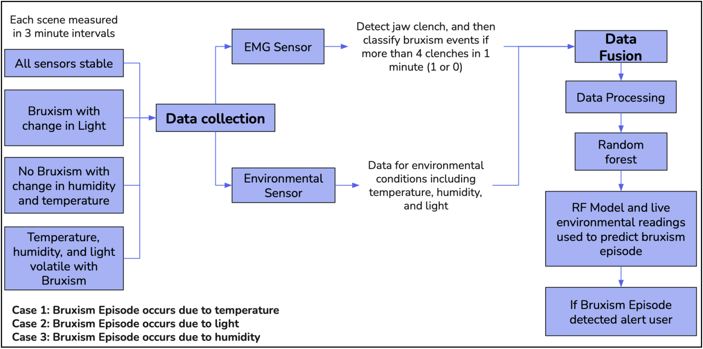
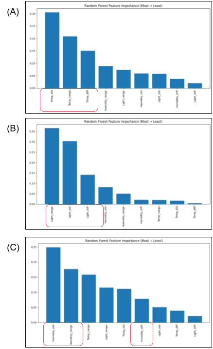

**Problem:** Sleep bruxism (teeth grinding and clenching) affects about 10% of adults, but most 
people don't know when or why it happens. The clinical standard, polysomnography, requires an 
overnight stay in a sleep lab, and environmental triggers of the micro-arousals linked to bruxism, 
such as light, temperature, and humidity, are hard to track at home.

**My contribution:** This was a graduate course project (MIE1050) built with two teammates. My 
contributions centered on the ML pipeline and data engineering:

- **Sensor fusion and data alignment:** upsampled the low-frequency environmental sensor data to 
align with the high-frequency EMG timeline, and extracted dynamic features per sensor 
(instantaneous change, rolling variance, and rolling range over 5-second windows)
- **ML pipeline:** trained a Random Forest classifier for each of three trigger cases 
(temperature-, light-, and humidity-dominant), with only 1–2 misclassifications out of about 
70,000 validation samples per case
- **Feature importance analysis:** confirmed that the intended trigger ranked highest in learned 
feature importance for every case, including scenes where the other sensors were also changing
- **Risk analysis:** varied each dominant feature while holding the others fixed to map how 
predicted bruxism probability changes, producing user-facing thresholds (for example, risk rising 
once light levels swing by more than about 170 lux)

**Result:** On controlled test sessions with simulated clenching and deliberately induced changes 
in light, temperature, and humidity, the system detected bruxism episodes in real time, showed an 
alert on its LCD, and identified the dominant trigger. Temperature and humidity moved together in 
practice, but the model still ranked the correct one as most important in each case. The main 
limitation is the data: about 12 minutes of scripted sessions per case rather than overnight 
recordings from people with bruxism, so the next step would be validating on real sleep data.

**Tools:** Python (PySerial, scikit-learn, pandas, joblib), Arduino, EMG sensing, Adafruit BME680, 
photoresistor